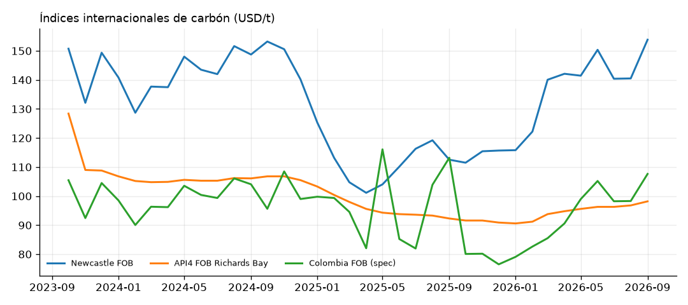
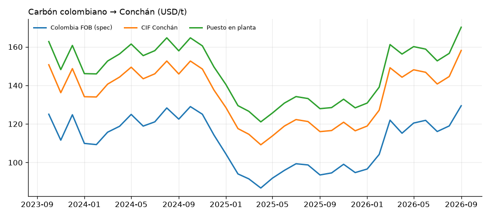
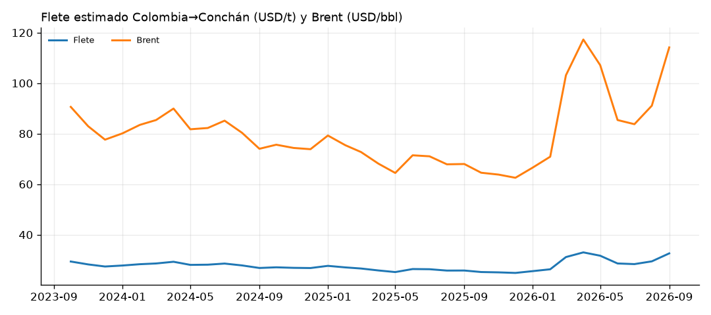
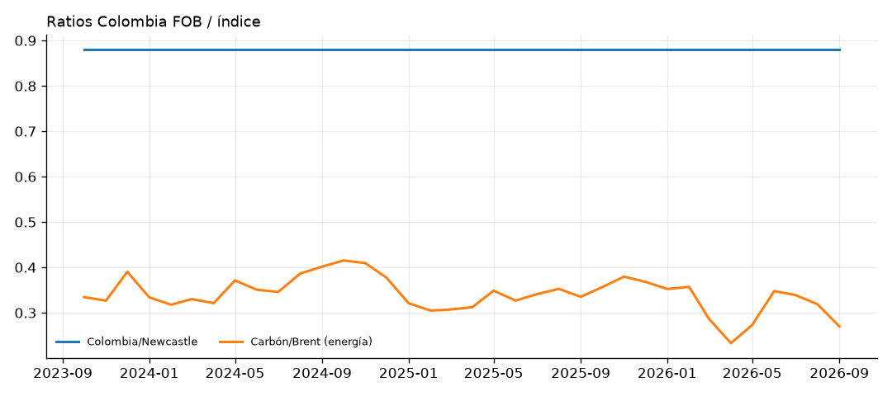

# Monitor de carbón importado — Puerto Conchán

_Actualizado: 2026-10-22 · Último mes con índice de referencia: 2026-09_

## Alertas

- ▲ Newcastle FOB (USD/t): +8.8% m/m (147.10, 2026-09)
- ▲ Colombia FOB, spec contrato (USD/t): +8.8% m/m (129.45, 2026-09)
- ▲ Flete Colombia→Conchán (USD/t): +11.9% m/m (28.46, 2026-09)
- ⚠ Flete Colombia→Conchán (USD/t) fuera de rango histórico: z=+2.2 vs 24 meses
- ▲ Puesto en planta (USD/t): +8.7% m/m (170.19, 2026-09)
- ▲ Brent (USD/bbl): +28.5% m/m (116.80, 2026-09)
- ⚠ Brent (USD/bbl) fuera de rango histórico: z=+2.2 vs 24 meses
- 💰 Carbón puesto en planta 170.2 USD/t supera el presupuesto de 160.0 USD/t (+6.4%)

## Carbón Colombia puesto en planta

| Concepto | Valor |
|---|---:|
| FOB Colombia, spec contrato (USD/t) | 129.45 |
| Flete Colombia→Conchán (USD/t) | 28.46 |
| CIF Conchán (USD/t) | 158.14 |
| Puesto en planta (USD/t) | 170.19 |
| Puesto en planta (PEN/t) | 575.20 |
| Puesto en planta (USD/GJ) | 6.78 |
| Puesto en planta (USD/Gcal) | 28.37 |
| IGV a pagar en aduana, crédito fiscal (USD/t) | 28.47 |
| Costo anual estimado (MUSD) | 42.5 |
| Presupuesto puesto en planta (USD/t) | 160.00 |
| Fuente del FOB | estimado: Newcastle × ratio Colombia/Newcastle |

Spec 6000 kcal/kg NAR. Ratio Colombia/API2: 0.850 (valor por defecto); Colombia/Newcastle: 0.880 (valor por defecto). Factor de calibración del flete: 1.00.

## Precios y costos

| Indicador | Mes | Último | m/m | a/a | Prom. 3m | Prom. 12m | Rango 24m | z 24m |
|---|---|---:|---:|---:|---:|---:|---|---:|
| Newcastle FOB (USD/t) | 2026-09 | **147.10** | +8.8% | +38.4% | 138.07 | 126.26 | 98.60 – 147.10 | 1.7 |
| API4 FOB Richards Bay (USD/t) | 2026-09 | **98.20** | +1.4% | +6.4% | 97.10 | 93.97 | 90.60 – 106.80 | 0.4 |
| Colombia FOB, spec contrato (USD/t) | 2026-09 | **129.45** | +8.8% | +38.4% | 121.50 | 111.11 | 86.77 – 129.45 | 1.7 |
| Flete Colombia→Conchán (USD/t) | 2026-09 | **28.46** | +11.9% | +27.6% | 26.11 | 24.68 | 21.51 – 28.85 | 2.2 |
| CIF Conchán (USD/t) | 2026-09 | **158.14** | +9.4% | +36.3% | 147.83 | 135.99 | 109.19 – 158.14 | 1.8 |
| Puesto en planta (USD/t) | 2026-09 | **170.19** | +8.7% | +33.0% | 159.85 | 147.96 | 121.08 – 170.19 | 1.8 |
| Puesto en planta (PEN/t) | 2026-09 | **575.20** | +9.2% | +28.4% | 540.50 | 502.66 | 432.25 – 618.41 | 1.3 |
| Puesto en planta (USD/GJ) | 2026-09 | **6.78** | +8.7% | +33.0% | 6.36 | 5.89 | 4.82 – 6.78 | 1.8 |
| Brent (USD/bbl) | 2026-09 | **116.80** | +28.5% | +71.8% | 97.03 | 86.42 | 62.70 – 120.40 | 2.2 |
| Tipo de cambio (PEN/USD) | 2026-09 | **3.380** | +0.5% | -3.5% | 3.382 | 3.396 | 3.357 – 3.780 | -1.0 |

## Ratios

| Indicador | Mes | Último | m/m | a/a | Prom. 3m | Prom. 12m | Rango 24m | z 24m |
|---|---|---:|---:|---:|---:|---:|---|---:|
| Colombia FOB / Newcastle | 2026-09 | **0.880** | +0.0% | +0.0% | 0.880 | 0.880 | 0.880 – 0.880 | 1.8 |
| Carbón vs Brent (USD/GJ ÷ USD/GJ) | 2026-09 | **0.270** | -15.3% | -19.4% | 0.309 | 0.323 | 0.233 – 0.415 | -1.5 |
| Flete / CIF | 2026-09 | **0.180** | +2.4% | -6.4% | 0.176 | 0.182 | 0.153 – 0.204 | -0.2 |

## Gráficos (últimos 36 meses)

## Estado de las fuentes (última descarga)

| Fuente | Observaciones | Estado |
|---|---:|---|
| fred | 0 | ⚠ FRED PCOALAUUSDM falló: respuesta inesperada: '<!doctype html>\n<html lang="en">\n<head>\n    <title>Site Maintenance / St. Louis Fed<</title>\n    <link href="https://fon' FRED MCOILBRENTEU falló: respuesta inesperada: '<!doctype html>\n<html lang="en">\n<head>\n    <title>Site Maintenance / St. Louis Fed<</title>\n    <link href="https://fon' FRED COLCCUSMA02STM falló: respuesta inesperada: '<!doctype html>\n<html lang="en">\n<head>\n    <title>Site Maintenance / St. Louis Fed<</title>\n    <link href="https://fon' |
| banco_mundial | 279 | ✅ OK |
| bcrp | 94 | ✅ OK |
| comtrade | 0 | ⚠ Comtrade pe_imp_carbon_col_cif 202410 falló: 400 Client Error: Bad Request for url: https://comtradeapi.un.org/public/v1/preview/C/M/HS?reporterCode=604&partnerCode=170&cmdCode=270112&flowCode=M&period=202410%2C202411%2C Comtrade pe_imp_carbon_col_cif 202510 falló: 400 Client Error: Bad Request for url: https://comtradeapi.un.org/public/v1/preview/C/M/HS?reporterCode=604&partnerCode=170&cmdCode=270112&flowCode=M&period=202510%2C202511%2C Comtrade pe_imp_carbon_col_cif: sin registros (HTTP 400) {"error":"Maximum number of periods for preview is 1","details":null} |
| investing | 0 | — sin archivos |
| manual | 0 | — sin archivos |

## Frescura de datos por serie

| Serie | Último mes |
|---|---|
| `brent_bm` | 2026-09 |
| `carbon_bm_australia_fob` | 2026-09 |
| `carbon_bm_sudafrica_fob` | 2026-09 |
| `fx_pen_usd` | 2026-10 |

---
_Fuentes: FRED/IMF, Banco Mundial (Pink Sheet), BCRP, UN Comtrade, CSV de Investing.com y cotizaciones propias. Los valores modelados son estimaciones; ver README para la metodología._
