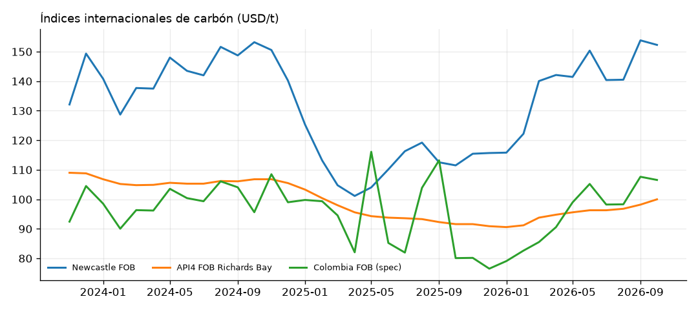
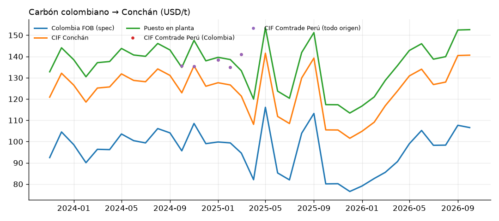
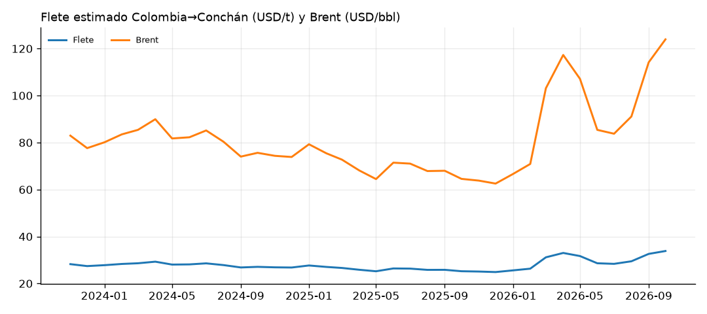
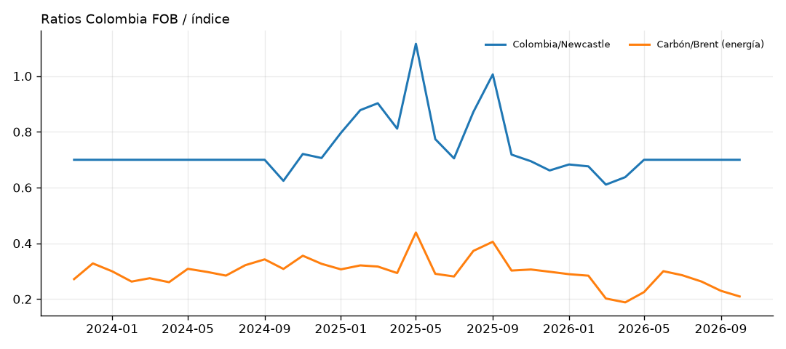

# Monitor de carbón importado — Puerto Conchán

_Actualizado: 2026-11-09 · Último mes con índice de referencia: 2026-10_

## Alertas

- ⚠ Flete Colombia→Conchán (USD/t) fuera de rango histórico: z=+2.2 vs 24 meses
- ▲ Brent (USD/bbl): +8.6% m/m (123.93, 2026-10)
- ⚠ Brent (USD/bbl) fuera de rango histórico: z=+2.3 vs 24 meses

## Carbón Colombia puesto en planta

| Concepto | Valor |
|---|---:|
| FOB Colombia, spec contrato (USD/t) | 106.56 |
| Flete Colombia→Conchán (USD/t) | 33.83 |
| CIF Conchán (USD/t) | 140.60 |
| Puesto en planta (USD/t) | 152.59 |
| Puesto en planta (PEN/t) | 525.35 |
| Puesto en planta (USD/GJ) | 6.07 |
| Puesto en planta (USD/Gcal) | 25.43 |
| IGV a pagar en aduana, crédito fiscal (USD/t) | 25.31 |
| Costo anual estimado (MUSD) | 38.1 |
| Presupuesto puesto en planta (USD/t) | 160.00 |
| Fuente del FOB | estimado: Newcastle × ratio Colombia/Newcastle |

Spec 6000 kcal/kg NAR. Ratio Colombia/API2: 0.850 (valor por defecto); Colombia/Newcastle: 0.700 (calibrado con Comtrade). Factor de calibración del flete: 1.16.

## Precios y costos

| Indicador | Mes | Último | m/m | a/a | Prom. 3m | Prom. 12m | Rango 24m | z 24m |
|---|---|---:|---:|---:|---:|---:|---|---:|
| Newcastle FOB (USD/t) | 2026-10 | **152.30** | -1.0% | +36.6% | 148.88 | 135.85 | 101.14 – 153.84 | 1.5 |
| API4 FOB Richards Bay (USD/t) | 2026-10 | **100.00** | +1.8% | +9.2% | 98.33 | 94.67 | 90.60 – 106.80 | 0.9 |
| Colombia FOB, spec contrato (USD/t) | 2026-10 | **106.56** | -1.0% | +33.0% | 104.17 | 92.45 | 76.52 – 116.10 | 1.0 |
| Flete Colombia→Conchán (USD/t) | 2026-10 | **33.83** | +3.8% | +34.1% | 31.96 | 29.21 | 24.87 – 33.83 | 2.2 |
| CIF Conchán (USD/t) | 2026-10 | **140.60** | +0.1% | +33.3% | 136.34 | 121.85 | 101.54 – 141.52 | 1.4 |
| Puesto en planta (USD/t) | 2026-10 | **152.59** | +0.1% | +30.0% | 148.31 | 133.78 | 113.40 – 153.51 | 1.4 |
| Puesto en planta (PEN/t) | 2026-10 | **525.35** | +2.0% | +31.1% | 503.72 | 454.81 | 381.84 – 561.96 | 1.0 |
| Puesto en planta (USD/GJ) | 2026-10 | **6.07** | +0.1% | +30.0% | 5.90 | 5.33 | 4.51 – 6.11 | 1.4 |
| CIF Perú desde Colombia — Comtrade (USD/t) | 2025-03 | **140.94** | +4.4% | — | 138.11 | 137.05 | 135.04 – 140.94 | — |
| CIF Perú desde todo origen — Comtrade (USD/t) | 2025-03 | **140.94** | +4.4% | — | 138.11 | 137.05 | 135.04 – 140.94 | — |
| Brent (USD/bbl) | 2026-10 | **123.93** | +8.6% | +92.0% | 109.72 | 90.81 | 62.54 – 123.93 | 2.3 |
| Tipo de cambio (PEN/USD) | 2026-10 | **3.443** | +1.9% | +0.8% | 3.395 | 3.398 | 3.357 – 3.780 | -0.5 |
| Tipo de cambio (COP/USD) | 2026-10 | **3,185.25** | +0.0% | -17.9% | 3,167.14 | 3,520.41 | 3,130.92 – 4,412.06 | -1.7 |

## Ratios

| Indicador | Mes | Último | m/m | a/a | Prom. 3m | Prom. 12m | Rango 24m | z 24m |
|---|---|---:|---:|---:|---:|---:|---|---:|
| Colombia FOB / Newcastle | 2026-10 | **0.700** | +0.0% | -2.6% | 0.700 | 0.680 | 0.611 – 1.116 | -0.5 |
| Carbón vs Brent (USD/GJ ÷ USD/GJ) | 2026-10 | **0.209** | -8.8% | -30.7% | 0.234 | 0.257 | 0.188 – 0.439 | -1.4 |
| Flete / CIF | 2026-10 | **0.241** | +3.7% | +0.6% | 0.234 | 0.240 | 0.178 – 0.267 | 0.6 |
| CIF modelo / CIF Comtrade Perú | 2025-03 | **0.861** | -8.2% | — | 0.907 | 0.926 | 0.861 – 1.002 | — |
| Participación de Colombia en importaciones de Perú (t) | 2025-03 | **1.000** | +0.0% | — | 1.000 | 1.000 | 1.000 – 1.000 | — |

## Gráficos (últimos 36 meses)

## Estado de las fuentes (última descarga)

| Fuente | Observaciones | Estado |
|---|---:|---|
| fred | 280 | ✅ OK |
| banco_mundial | 282 | ✅ OK |
| bcrp | 95 | ✅ OK |
| comtrade | 62 | ✅ OK |
| investing | 0 | — sin archivos |
| manual | 0 | — sin archivos |

## Frescura de datos por serie

| Serie | Último mes |
|---|---|
| `brent` | 2026-10 |
| `brent_bm` | 2026-10 |
| `carbon_bm_australia_fob` | 2026-10 |
| `carbon_bm_sudafrica_fob` | 2026-10 |
| `carbon_newcastle_fob` | 2026-09 |
| `co_exp_carbon_mundo_fob_usd_t` | 2026-04 |
| `co_exp_carbon_mundo_fob_vol_t` | 2026-04 |
| `co_exp_carbon_pe_fob_usd_t` | 2025-09 |
| `co_exp_carbon_pe_fob_vol_t` | 2025-09 |
| `fx_cop_usd` | 2026-09 |
| `fx_pen_usd` | 2026-11 |
| `pe_imp_carbon_col_cif_usd_t` | 2025-03 |
| `pe_imp_carbon_col_cif_vol_t` | 2025-03 |
| `pe_imp_carbon_mundo_cif_usd_t` | 2025-03 |
| `pe_imp_carbon_mundo_cif_vol_t` | 2025-03 |

---
_Fuentes: FRED/IMF, Banco Mundial (Pink Sheet), BCRP, UN Comtrade, CSV de Investing.com y cotizaciones propias. Los valores modelados son estimaciones; ver README para la metodología._
